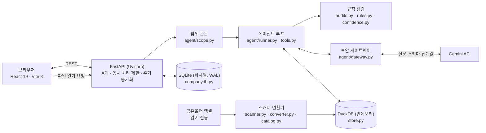
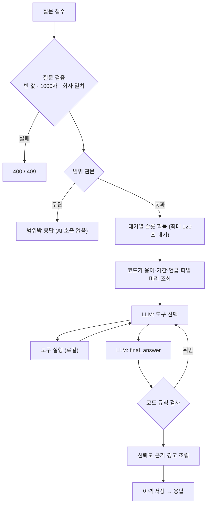

# 트루소스(TrueSource) 기술명세서

| 항목 | 내용 |
| :--- | :--- |
| 문서 버전 | 1.0 |
| 작성일 | 2026-10-04 |
| 기준 | `main` 브랜치 구현 (백엔드 `backend/app`, 프론트엔드 `src`) |
| 대상 독자 | 심사위원, 개발·운영 담당자 |
| 관련 문서 | [README](../README.md), [백엔드 README(데이터 계층)](../backend/README.md), 설계서 『트루소스 AI 에이전트 동작 설계서』 |

**대회 제출 규정 대응**

| 규정 | 이 문서의 위치 |
| :--- | :--- |
| 대회기간 중 **신규개발분** 구분 표기 | 2장 개발 구분 |
| 생성형 AI·오픈소스·API·데이터 **출처** 구분 표기 | 3장 정보 출처 |
| AI Agent 6요소(Goal·Planning·Reasoning·Tool Use·Memory·Feedback) | 4장 |
| 테스트·검증 증거 | 18장 |

이 문서는 **구현된 동작**을 기준으로 씁니다. 설계서와 다르거나 아직 구현하지 않은 부분은 "한계·미구현"(17장)에 따로 적었습니다.

---

## 목차

1. [개요](#1-개요)
2. [개발 구분 — 기존 개발과 8일 개발](#2-개발-구분--기존-개발과-8일-개발)
3. [정보 출처](#3-정보-출처)
4. [AI Agent 6요소 대응](#4-ai-agent-6요소-대응)
5. [시스템 구성](#5-시스템-구성)
6. [기능 요구사항과 구현 대응](#6-기능-요구사항과-구현-대응)
7. [데이터 명세](#7-데이터-명세)
8. [분석 파이프라인(공유폴더 → 표)](#8-분석-파이프라인공유폴더--표)
9. [에이전트 명세](#9-에이전트-명세)
10. [신뢰도 판정 명세](#10-신뢰도-판정-명세)
11. [보안 명세](#11-보안-명세)
12. [변경 동기화 명세](#12-변경-동기화-명세)
13. [API 명세](#13-api-명세)
14. [동시 사용·성능 명세](#14-동시-사용성능-명세)
15. [설정·배포 명세](#15-설정배포-명세)
16. [오류 처리 명세](#16-오류-처리-명세)
17. [한계·미구현](#17-한계미구현)
18. [검증(테스트) 명세](#18-검증테스트-명세)
19. [부록](#19-부록)

---

## 1. 개요

### 1.1 목적

중소기업 실무자가 **사내 공유폴더의 엑셀 데이터에 질문**하고, **받은 숫자를 쓰기 전에 검증**할 수 있게 하는 AI 에이전트입니다. 원본 엑셀은 사내 PC에만 있고, 외부 LLM은 계획·판단·문장 작성만 맡습니다.

### 1.2 해결하려는 문제

| 문제 | 트루소스의 대응 |
| :--- | :--- |
| 같은 데이터의 여러 버전·사본(`_최종`, `(1)`, 백업)이 섞여 어느 숫자가 맞는지 모름 | 버전·사본 판정, 기준 파일 선택, 구버전·사본 사용 시 경고 |
| 집계 파일과 원장의 값이 달라도 알아채기 어려움 | **교차검증 필수**, 불일치 시 두 기준 병기와 원인 추적 |
| AI가 틀린 숫자를 자신 있게 답함 | 답변 속 숫자를 코드가 다시 대조, 신뢰도를 규칙으로 판정 |
| 사내 데이터를 외부 AI에 보내는 것에 대한 불안 | 원본 행 미전송, 이름 마스킹, 감사 로그 |
| 파일이 바뀌면 과거 답변이 낡은 줄 모름 | 변경 감지, 지난 답변의 근거 변경 알림 |

### 1.3 설계 원칙

1. **LLM은 판단, 코드는 판정**: 무엇을 확인할지는 LLM이, 무엇이 사실인지는 코드가 정한다. 계산·출처·신뢰도·숫자 검증은 코드만 생성한다.
2. **원본은 밖으로 안 나간다**: 외부 LLM에는 질문·스키마·카탈로그 요약·집계값만 보내며, 모든 호출이 단일 게이트웨이 함수를 통과한다.
3. **신뢰도는 규칙으로**: LLM의 "확신해요"를 쓰지 않고 정해진 규칙표로 등급·이유·확인할 것을 만든다.

### 1.4 범위

| 포함 | 제외 |
| :--- | :--- |
| 공유폴더 엑셀(`.xlsx`, `.xlsm`) 읽기 전용 분석 | 엑셀 수정·저장, `.xls`(구형식) 분석 |
| 질문형·검증형·찾기형 질의응답, 되묻기, 범위 밖 안내 | 이미지·PDF·워드 문서 분석 |
| 회사 단위 이력·용어사전, 같은 회사 내 동시 사용 | 사용자 인증(비밀번호), 한 서버에서 여러 회사 동시 서비스 |
| 폴더 변경 감지와 알림 | 파일 단위 증분 재색인(전체 재분석 방식) |

### 1.5 용어

| 용어 | 뜻 |
| :--- | :--- |
| 카탈로그 | 분석된 파일·시트·컬럼의 목록과 메타데이터 |
| 표(table) | 시트 하나를 변환한 DuckDB 표. 이름은 `t_0001` 형식 |
| 근거(source) | 답변을 만든 파일·시트·행·열 |
| 교차검증 | 같은 지표를 서로 다른 파일의 표에서 따로 계산해 비교 |
| 지문 | 파일의 경로·크기·수정시각·해시 |
| 마스킹 | 이름·번호를 `{팀1}` 같은 자리표시자로 바꿔 외부로 보내는 처리 |
| 신호 | 신뢰도를 구성하는 점검 영역(매핑·교차검증·데이터 품질·실행 이상 등) |

---

## 2. 개발 구분 — 기존 개발과 8일 개발

### 2.1 구분 기준

2026년 제4회 경남 AI·SW 경진대회는 **대회기간(2026.09.29 ~ 10.06, 8일) 중 신규 개발분**과 그 밖의 자산(생성형 AI·오픈소스·API·데이터)을 구분해 표기하도록 요구합니다. 이 문서는 다음 기준으로 나눕니다.

| 구분 | 정의 |
| :--- | :--- |
| **기존 개발** | 대회 시작 전부터 존재하거나 팀이 만들지 않은 것: 오픈소스 라이브러리·프레임워크, 외부 AI 모델과 API, 기반 기술(SQLite 등) |
| **8일 개발(신규)** | 대회기간 중 팀이 새로 만든 것: 기획·설계 문서, 애플리케이션 코드, 테스트, 가상 데이터셋, 화면·문서 |

저장소의 이력으로 확인되는 사실:

- 이 저장소(`truesource-web`)의 **첫 커밋은 2026-10-01(개발 3일차)** 이고, 대회 시작일(09-29) 이전의 커밋은 없다.
- 애플리케이션 코드는 모두 첫 커밋 이후에 작성되었다. 대회 이전에 만든 자체 코드를 가져와 쓰지 않았다.

### 2.2 요약

| 구분 | 내용 | 세부 |
| :--- | :--- | :--- |
| 기존 개발(외부 자산) | 오픈소스 라이브러리 16종, Gemini 모델·API, SQLite | 3장 |
| 8일 개발(신규) | 트루소스 전체: 백엔드 약 6,150줄, 테스트 약 3,480줄(215개), 프론트엔드 약 1,820줄, 가상 데이터셋, 설계 문서 | 2.4절 |

### 2.3 8일 개발 일정과 산출물

계획은 『재호동권 팀 · 트루소스 8일 개발 타임라인』이고, 산출물은 **커밋 이력과 문서 수정일을 근거**로 적었습니다.

| 일차 | 날짜 | 계획 단계 | 이 날의 성과 (근거) |
| :---: | :--- | :--- | :--- |
| 1 | 09-29 (화) | 문제·범위 확정 | **대회 규정과 평가 기준을 분석해 개발 방향을 확정.** AI Agent 인정 기준 6요소, MVP 목표, 제출물 5종, 평가 100점 배점을 정리하고 8일 개발 일정을 수립 |
| 2 | 09-30 (수) | Agent 골격 설계 | **"LLM은 판단, 코드는 판정"이라는 설계 원칙을 세우고 구조를 문서화.** 『문제·범위 확정·Agent 골격』과 『AI 에이전트 동작 설계서』를 작성하고, 교차검증을 시연할 수 있도록 **가상 데이터셋 ㈜가온산업**(엑셀 138개, 정답지 포함)을 생성 |
| 3 | 10-01 (목) | 핵심기능 구현 | **"에이전트가 볼 지도"인 데이터 계층 구현.** 공유폴더 스캔 → 시트 표 변환 → DuckDB 저장 → 카탈로그·값 색인을 구현하고 전용 테스트를 작성(`b8bfa19`). 화면 골격도 함께 마련(`1adf75d`) |
| 4 | 10-02 (금) | End-to-End 흐름 확보 | 저장소 커밋 없음 |
| 5 | 10-03 (토) | 오류수정·안정화 | **최초 End-to-End 성공: 질문 → LLM 도구 선택 → 로컬 도구 실행 → 근거와 신뢰도가 붙은 답변.** Gemini 에이전트·도구 8개·보안 게이트웨이·회사별 DB·신뢰도 규칙을 구현하고, 근거의 파일·행 표시와 파일 열기, 편집 중 감지, 내용 없음 안내, API 키 오류 안내를 추가. **실제 질문 10여 개를 브라우저로 돌려 결함을 찾아 수정**(엉뚱한 지표로의 교차검증, 기간 오표기, 화면 크래시 등) |
| 6 | 10-04 (일) | 테스트·검증 | **검증 체계를 갖추고 사용 환경을 확장.** 자동 테스트 215개(엑셀 엣지케이스, 50개 동시 질문 포함), 사이드바 파일 트리·수동 동기화·범위 밖 질문 관문, 동시 질문 대기열, 외장 드라이브 DB 오류 수정, 트루소스 아이콘과 입체 로딩, README·기술명세서 |
| 7 | 10-05 (월) | 제출물 작성 | 예정: 개발완료보고서, AI Agent 기술설명서, 발표자료, 시연영상 |
| 8 | 10-06 (화) | 최종 검토·제출 | 예정: 최종 검토와 제출(마감) |

- 저장소 커밋은 병합을 제외하고 **15개**, 병합된 풀 리퀘스트는 10개(작성 시점)입니다.
- 최초 End-to-End(질문 → 도구 → 답변)는 **10/3**에 실행·검증했습니다.

### 2.4 신규 개발분 상세 (모듈별 규모)

줄 수는 `main` 브랜치의 소스 파일(`.py`, `.jsx`, `.js`, `.css`) 기준이며 빈 줄·주석을 포함합니다.

**백엔드 `backend/app` — 약 6,150줄**

| 모듈 | 줄 수 | 개발 내용 |
| :--- | ---: | :--- |
| `agent/audits.py` | 340 | 신뢰도 규칙 발동 지점(파일·행·기간) |
| `agent/confidence.py` | 168 | 신호별 등급·이유·확인 안내 |
| `agent/gateway.py` | 390 | 보안 게이트웨이: 마스킹·인젝션 차단·감사 로그·키 오류 분류 |
| `agent/glossary.py` | 188 | 용어사전·기간 규칙 |
| `agent/numbers.py` | 54 | 답변 속 숫자 재대조 |
| `agent/rules.py` | 434 | 신뢰도 규칙 52개 정의 |
| `agent/runner.py` | 694 | 에이전트 루프, 규칙 강제, 응답 조립 |
| `agent/scope.py` | 160 | 범위 밖 질문 관문 |
| `agent/tools.py` | 1,328 | 도구 8개, 합산·조회 기간 계산 |
| `catalog.py` | 181 | 부서 분류, 버전 계열·기준일·사본·충돌 판정 |
| `companydb.py` | 364 | 회사별 SQLite(이력·용어사전·지문·동기화 로그·용어 후보) |
| `config.py` | 100 | 설정값·환경 변수 |
| `converter.py` | 394 | 시트 → 표 변환 규칙(헤더·형식·소계 행·오류 셀) |
| `limiter.py` | 41 | 동시 질문 상한·대기열 |
| `main.py` | 349 | API 서버: 엔드포인트, 요청 검증, 동시 처리 제한, 주기 동기화 루프 |
| `opener.py` | 78 | 근거 파일을 사용자 PC의 엑셀로 열기(안전 검사) |
| `scanner.py` | 197 | 폴더 순회, 잠금 파일·편집 중 사용자 이름 읽기, 경로 안전 검사 |
| `service.py` | 399 | 스캔 실행·진행률, 동기화, 근거 변경 확인 |
| `store.py` | 291 | 인메모리 DuckDB 저장소, 값 색인 |

**프론트엔드 `src` — 약 1,820줄**

| 위치 | 줄 수 | 개발 내용 |
| :--- | ---: | :--- |
| `src/App.jsx·main.jsx·constants.js·index.css` | 533 | 화면 흐름, 전역 스타일 |
| `src/api/` | 64 | 백엔드 호출 |
| `src/components/` | 916 | 시작 화면·사이드바·로딩·근거·경고·이력·용어사전·감사 로그·알림 |
| `src/components/cards/` | 179 | 답변·판정표·근거 표·신뢰도 게이지·실행 과정 카드 |
| `src/layouts/` | 130 | 질문형·검증형·찾기형·되묻기·내용 없음·범위 밖 화면 |

**테스트 `backend/tests` — 약 3,480줄, 테스트 215개**

실제 Gemini를 쓰지 않고도 게이트웨이·규칙·도구가 동작하도록, LLM만 스크립트로 바꾸는 테스트 도구와 사내 엑셀 엣지케이스를 재현하는 합성 엑셀 생성 도구를 함께 만들었습니다(18장).

**신규 개발 문서·데이터**

| 산출물 | 내용 |
| :--- | :--- |
| 『AI 에이전트 동작 설계서』(10쪽) | 설계 원칙, 도구·흐름, 신뢰도 규칙, 보안 구조, 데이터셋·검증 계획 |
| 『문제·범위 확정·Agent 골격』 | 문제 정의, 범위 동결, 골격 |
| 『8일 개발 타임라인』 | 일정 계획 |
| 가상 데이터셋 ㈜가온산업 | 진실 원장에서 파생한 엑셀 138개(2024-01~2026-09), 일부러 넣은 오류와 정답지 |
| README·기술명세서 | 화면 캡처 12장, 다이어그램, 규칙표 |

### 2.5 설계와 구현의 차이

설계서를 그대로 구현하지 않은 부분과, 설계에 없던 것을 8일 동안 추가한 부분입니다.

| 구분 | 내용 |
| :--- | :--- |
| 설계서에 있었으나 구현하지 않음 | Parquet 계산 캐시, `watchdog` 실시간 감시, 질문 시점 단일 파일 재색인(주기 스캔 + 수동 동기화 + 질문 시점 변경 확인으로 대체) |
| 설계 의도를 코드로 더 강하게 구현 | 신뢰도 규칙을 "4신호"에서 **52개 규칙**으로 구체화, 교차검증 독립성·순위 검증·기간 표기 검증·이중 집계 방지 |
| 설계에 없던 추가 | 근거 파일 열기, 편집 중 감지, 범위 밖 질문 관문, 지난 답변의 근거 변경 알림, 동시 질문 대기열, API 키 오류 안내, 입체 로딩 |

---

## 3. 정보 출처

### 3.1 생성형 AI

| 구분 | 이름 | 사용 위치와 역할 | 비고 |
| :--- | :--- | :--- | :--- |
| 제품 내 사용 | **Gemini API**(Google) | 질문 처리 중 도구 선택·근거 판단·답변 문장 작성. 기본 모델 `gemini-3.8-flash`, 개발 중 `gemini-3.5-flash-lite`도 사용 | 계산·출처·신뢰도·숫자 검증은 코드가 한다. 원본 행은 보내지 않고 이름은 마스킹해 보낸다(10장) |
| 개발 보조 | **Claude Code**(Anthropic) | 코드·테스트·문서의 작성 보조 | 요구사항·설계·결정·검증 기준은 팀이 정하고 결과를 확인했다. 저장소 커밋 15개 중 12개에 공동 작성자로 표기 |

생성형 AI가 만든 결과의 정확성은 코드 규칙(교차검증 필수, 숫자 재대조, 신뢰도 판정)으로 사용자 앞에서 다시 검증합니다.

### 3.2 오픈소스

모두 상업적 사용이 가능한 허용적 라이선스입니다. 버전은 개발 환경에서 확인한 값입니다.

**백엔드 (Python 3.13 기준, 3.10 이상 지원)**

| 이름 | 버전 | 라이선스 | 용도 |
| :--- | :--- | :--- | :--- |
| FastAPI | 0.142 | MIT | API 서버 |
| Starlette | 1.7 | BSD-3-Clause | FastAPI 하부(웹 프레임워크) |
| Pydantic | 2.13 | MIT | 요청·응답 검증 |
| Uvicorn | 0.54 | BSD-3-Clause | ASGI 서버 |
| DuckDB | 1.5 | MIT | 인메모리 분석 데이터 저장·집계 |
| openpyxl | 3.1 | MIT | 엑셀 읽기 |
| google-genai | 2.28 | Apache-2.0 | Gemini API 클라이언트 |
| python-dotenv | 1.2 | BSD-3-Clause | `.env` 읽기 |
| SQLite | 3.50 | 퍼블릭 도메인 | 회사별 데이터(Python 표준 라이브러리 포함) |

**프론트엔드 (Node.js 20.19+ / 22.12+)**

| 이름 | 버전 | 라이선스 | 용도 |
| :--- | :--- | :--- | :--- |
| React / React DOM | 19.3 | MIT | 화면 |
| Vite | 8.3 | MIT | 개발 서버·빌드 |
| @vitejs/plugin-react | 6.1 | MIT | React 빌드 플러그인 |

**개발·검증 도구(배포물에 포함되지 않음)**

| 이름 | 버전 | 라이선스 | 용도 |
| :--- | :--- | :--- | :--- |
| pytest | 9.1 | MIT | 테스트 |
| httpx | 0.28 | BSD-3-Clause | API 테스트 클라이언트 |
| ruff | 0.16 | MIT | 파이썬 린트·포맷 |
| oxlint | 1.86 | MIT | 프론트엔드 린트 |
| puppeteer-core | — | Apache-2.0 | 브라우저 자동 조작으로 실제 질문을 돌려 검증하고 화면을 캡처(저장소에 포함하지 않음) |
| Mermaid | — | MIT | README 다이어그램(GitHub 렌더링) |

### 3.3 API·외부 서비스

| 서비스 | 용도 | 전송 내용 | 인증·키 관리 |
| :--- | :--- | :--- | :--- |
| Gemini API(Google AI) | LLM 호출 | 마스킹된 질문, 스키마, 카탈로그 요약, 집계값. **원본 행·실명·사업자번호는 전송하지 않음** | API 키는 `backend/.env`에 두고 저장소에서 제외. 화면·로그에 키 값을 내보내지 않음 |

외부로 나간 내용은 감사 로그 화면에서 확인할 수 있습니다. 사내 데이터를 다루므로 **학습에 쓰이지 않는 조건의 유료 계정**을 쓰는 것을 설계 전제로 합니다(무료 등급은 호출 한도도 매우 작음). 그 밖의 외부 API는 사용하지 않습니다.

### 3.4 데이터

| 항목 | 내용 |
| :--- | :--- |
| 이름 | ㈜가온산업 가상 데이터셋 |
| 출처 | **팀이 직접 생성**(생성 스크립트 `gaon_datagen.py`, 난수 시드 고정으로 누구나 같은 결과 재생성) |
| 규모·기간 | 공유폴더 엑셀 138개, 2024-01 ~ 2026-09(시뮬레이션 기준일 2026-09-30) |
| 구성 | 하나의 "진실 원장"(거래처·품목·수주·매출·반품·입금·발주)에서 부서별·연도별 엑셀을 파생. 컬럼명·파일명을 부서마다 다르게 하고, 버전·사본·백업·잠금 파일을 포함 |
| 주입한 오류 | 집계 파일과 원장의 불일치(미반영 반품), 갱신 누락된 계약현황, 결측·중복 행, 오래된 버전, 사본, 프롬프트 인젝션 문구 2곳 등 |
| 정답지 | 진실 원장 CSV와 오류 목록(`정답지/`). **에이전트에는 제공하지 않으며** 테스트 채점에만 사용 |
| 저작권·개인정보 | 모든 회사명·사업자번호·인명은 **가상**이다. 공공데이터·실제 기업 데이터·개인정보를 사용하지 않았다 |
| 보관 | 저장소 밖에서 관리하며, 경로를 지정해 사용 |

### 3.5 기획·참고 자료

| 자료 | 용도 |
| :--- | :--- |
| 대회 공식 교육자료 『AI Agent 8일 완성』, 사업설명회 자료(V0.1) | AI Agent 인정 기준(6요소), 완성도 목표(MVP), 제출물, 평가 기준, 준수사항 |
| 팀 작성 문서(동작 설계서, 문제·범위 확정, 8일 타임라인) | 설계와 일정의 근거(2.3절) |
| 대기업용 AI 플랫폼의 "전용 계약 + 보안 게이트웨이" 원칙 | 설계 포지셔닝 참고 개념. 코드·자료를 가져오지 않고, 같은 원칙을 중소기업 PC 한 대 규모로 경량화해 **새로 구현**했다 |

### 3.6 디자인 자산

| 자산 | 출처 |
| :--- | :--- |
| 트루소스 아이콘(돋보기 + 체크), 파비콘, 배너 | 팀이 제작(SVG·CSS). 외부 이미지·아이콘 세트를 사용하지 않음 |
| 입체 로딩 애니메이션 | CSS 3D로 직접 구현(외부 애니메이션 라이브러리 없음) |
| 글꼴 | 파일을 포함하지 않고, 사용자 PC에 설치된 글꼴 이름을 지정만 함(Pretendard, Noto Sans KR, Malgun Gothic) |
| README 화면 캡처 | 가상 회사 데이터로 실제 앱을 실행해 캡처 |

### 3.7 저작권·개인정보·비밀 정보 점검

| 점검 | 결과 |
| :--- | :--- |
| 오픈소스 라이선스 | 전부 MIT·BSD·Apache·퍼블릭 도메인. 복제·수정·상업적 이용 허용 |
| 개인정보 | 가상 데이터만 사용. 실제 이름·사업자번호 없음 |
| 기업 비밀 | 실제 기업 데이터 없음. 제품은 원본 행을 외부로 보내지 않는 구조 |
| API 키·비밀번호 | 저장소에 포함하지 않음(`.env`는 `.gitignore`), 예시 파일에는 빈 값만 있음 |
| 시연·성능 수치 | 작성 시점에 실제로 실행해 측정한 값만 기재하고, 측정 조건을 함께 적음(14장) |

---

## 4. AI Agent 6요소 대응

대회는 Goal·Planning·Reasoning·Tool Use·Memory/State·Feedback 6요소 중 4개 이상을 요구합니다. 트루소스는 6개를 모두 **실제로 동작하는 코드**로 구현했습니다.

| 요소 | 트루소스의 구현 | 위치 |
| :--- | :--- | :--- |
| **Goal** | 사용자가 사내 엑셀에 대해 묻는 목표를 질문 유형(값을 묻기·주장 확인·자료 찾기)으로 이해하고, 엑셀과 무관한 질문은 목표 밖으로 걸러냄 | 범위 관문, 질문 유형 결정(9장) |
| **Planning** | LLM이 질문마다 도구 순서를 계획: 용어 조회 → 카탈로그 검색 → 집계 → 교차검증 → 차이 추적. 근거가 부족하면 재계획 | 에이전트 루프 |
| **Reasoning** | 근거가 충분한지, 불일치가 결론(순위)을 바꾸는지, 원인을 더 조사할지 LLM이 판단. 코드는 판단의 경계를 강제 | 교차검증·차이 추적 |
| **Tool Use** | 로컬 도구 8개가 실제로 파일 카탈로그·DuckDB·값 색인을 호출(검색·집계·교차검증·품질 조회). 외부 API는 Gemini | 9.3절 |
| **Memory/State** | 세션별 대화 기억("그럼 2위는?"), 회사별 질문 이력·용어사전·파일 지문(재시작 후에도 유지), 질문별 상태 객체 | 9.7절, 7.3절 |
| **Feedback** | 도구 실패 시 이유를 받아 조건을 고쳐 재시도(최대 2회), 숫자 불일치 시 재작성, 교차검증 불일치 시 원인 추적, 되묻기, 지난 답변의 근거 변경 알림 | 9.4절, 12장 |

**Workflow(한 줄 요약)**: 질문 → 범위 관문 → 미리 조회 → *LLM 계획* → *로컬 도구 실행* → *LLM 근거 판단*(부족하면 반복) → 답변 작성 → **코드 규칙 검사** → 신뢰도·근거·경고 조립 → 화면.

단순 프롬프트 출력이나 FAQ 챗봇이 아닌 이유: 파일을 실제로 읽고 계산하며, LLM의 다음 행동이 도구 결과에 따라 달라지고(질문 유형별로 도구 경로가 다름), 결과의 사실 여부를 코드가 다시 검증합니다.

---

## 5. 시스템 구성

### 5.1 배포 모델

- **회사마다 서버 1대**(사내 PC 또는 사내 서버)에서 백엔드와 프론트엔드를 실행한다.
- 같은 회사의 여러 직원이 브라우저로 접속해 **동시에** 사용한다.
- 서버 한 대는 **한 회사의 폴더**만 메모리에 올린다. 다른 회사 이름의 질문은 거절한다(`409`).
- 외부 통신은 Gemini API 호출뿐이다(게이트웨이를 통과한 내용만).

### 5.2 구성요소



| 구성요소 | 모듈 | 책임 |
| :--- | :--- | :--- |
| API 서버 | `app/main.py` | 엔드포인트, 요청 검증, 동시 처리 제한, 주기 동기화 루프 |
| 스캐너 | `app/scanner.py` | 폴더 순회, 파일 목록·잠금 파일 수집, 경로 안전 검사 |
| 변환기 | `app/converter.py` | 시트 → 헤더·형식이 정해진 표, 행 종류 표시 |
| 카탈로그 규칙 | `app/catalog.py` | 부서 분류, 버전 계열·기준일·사본 판정 |
| 분석 저장소 | `app/store.py` | 인메모리 DuckDB: 카탈로그·시트 표·값 색인 |
| 스캔 서비스 | `app/service.py` | 백그라운드 스캔, 진행률, 동기화, 지문 비교, 근거 변경 확인 |
| 회사 저장소 | `app/companydb.py` | 회사별 SQLite: 사용자·이력·용어사전·지문·동기화 로그 |
| 범위 관문 | `app/agent/scope.py` | 엑셀과 무관한 질문을 AI 호출 없이 거절 |
| 에이전트 | `app/agent/runner.py` | LLM 함수 호출 루프, 규칙 강제, 응답 조립 |
| 도구 | `app/agent/tools.py` | 로컬 도구 8개와 질문별 상태(`QuestionCtx`) |
| 규칙 발동 | `app/agent/audits.py` | 파일·행·기간 점검으로 신뢰도 규칙 발동 |
| 규칙 정의 | `app/agent/rules.py` | 신뢰도 규칙 52개의 신호·등급·제목·확인할 것 |
| 신뢰도 | `app/agent/confidence.py` | 신호별 등급, 최종 등급, 이유, 확인 안내 |
| 게이트웨이 | `app/agent/gateway.py` | 외부 LLM 호출의 유일한 통로, 마스킹·차단·감사 |
| 용어사전 | `app/agent/glossary.py` | 기본 용어, 기간 해석, 컬럼→지표 |
| 숫자 검증 | `app/agent/numbers.py` | 답변 속 숫자와 도구 결과 대조 |
| 대기열 | `app/limiter.py` | 동시 질문 상한과 대기 |
| 파일 열기 | `app/opener.py` | 근거 파일을 사용자 PC의 엑셀로 열기(안전 검사 포함) |

### 5.3 기술 스택

| 구분 | 기술 | 비고 |
| :--- | :--- | :--- |
| 프론트엔드 | React 19, Vite 8 | Node.js 20.19 이상 또는 22.12 이상 |
| 백엔드 | Python 3.10+, FastAPI, Uvicorn | 개발은 3.13에서 수행 |
| 엑셀 | openpyxl | 읽기 전용, 저장된 계산값 사용 |
| 분석 데이터 | DuckDB | 인메모리(재시작 시 재스캔) |
| 회사 데이터 | SQLite | 회사별 파일, WAL 저널 |
| LLM | Gemini API(`google-genai`) | 함수 호출, 기본 모델 `gemini-3.8-flash` |
| 품질 | pytest, ruff, oxlint | 테스트 215개 |

---

## 6. 기능 요구사항과 구현 대응

"검증"은 18장의 테스트 파일을 가리킵니다.

### 6.1 데이터 준비

| ID | 요구사항 | 구현 | 검증 |
| :--- | :--- | :--- | :--- |
| FR-01 | 사용자가 입력한 공유폴더 경로를 **읽기 전용**으로 분석한다. 시스템 폴더·허용 범위 밖·루트 전체는 거절한다 | `scanner.validate_scan_path`, `POST /api/scan` | `test_scanner`, `test_api` |
| FR-02 | 시트를 헤더·열 형식·행 종류가 정해진 표로 변환하고, 원래 엑셀 행 번호를 보존한다 | `converter.py` | `test_converter` |
| FR-03 | 파일마다 부서, 기준일, 신선도(`ok`/`stale`/`copy`), 사본 원본을 판정한다 | `catalog.py` | `test_catalog` |
| FR-04 | 짧은 텍스트 값(팀명·거래처명 등)을 값 색인으로 만들어 "값 → 위치"를 찾는다 | `store._index_values` | `test_store` |
| FR-05 | 폴더 변경(추가·수정·삭제·이동)을 파일 지문으로 구분해 기록한다 | `companydb.record_scan`, `diff_fingerprints` | `test_company` |
| FR-06 | 10분마다(설정 가능) 자동으로, 또는 사용자 요청으로 즉시 다시 읽는다. 자동은 변경이 있을 때만 | `service.auto_sync_once`, `sync_now`, `POST /api/sync` | `test_company`, `test_scope_and_sync` |
| FR-07 | 다른 사람이 열어 둔 파일(엑셀·LibreOffice 잠금 파일)과 열어 둔 사람 이름을 알아낸다 | `scanner.read_lock_owner` | `test_rules` |

### 6.2 질의응답

| ID | 요구사항 | 구현 | 검증 |
| :--- | :--- | :--- | :--- |
| FR-10 | 엑셀과 무관한 질문은 AI 호출 없이 안내한다(의심스러우면 통과) | `agent/scope.py` | `test_scope_and_sync` |
| FR-11 | 질문에서 용어·기간·언급된 파일을 코드가 미리 조회해 LLM에 함께 전달한다 | `tools.pre_lookup` | `test_questions` |
| FR-12 | LLM이 로컬 도구 8개를 골라 쓰며 근거를 모은다. 호출 10회·재시도 2회·120초 상한 | `runner._loop`, `tools.py` | `test_agent`, `test_questions` |
| FR-13 | 계산한 답은 **다른 파일의 같은 지표**로 교차검증하기 전에는 내보내지 않는다. 순위 질문은 전체 순위를 비교한다 | `runner._final`, `tools.cross_verify` | `test_agent`, `test_questions` |
| FR-14 | 교차검증이 불일치면 두 기준을 병기하고, 기준일 이후 입력된 거래로 원인 후보를 제시한다 | `tools.trace_difference` | `test_agent` |
| FR-15 | 답변 속 숫자(억·만원·원·%·소수)가 도구 결과에 없으면 거절하고 재작성시킨다 | `numbers.py`, `runner._final` | `test_agent` |
| FR-16 | 답변이 말한 기간과 인용한 숫자의 실제 조회 기간이 다르면 경고한다 | `tools.check_period_claim` (P3) | `test_questions` |
| FR-17 | 질문 유형(질문형·검증형·찾기형·되묻기·내용없음·범위밖)을 코드가 확정한다 | `runner._build_response` | `test_rules`, `test_agent` |
| FR-18 | 분석된 파일에서 못 찾으면 "내용 없음"과 찾아본 곳·분석 못 한 파일·비슷한 이름·다음 행동을 안내한다 | `runner._detect_no_data` | `test_rules`, `test_questions` |
| FR-19 | 모든 답변에 근거(파일·시트·행 범위·열·쓰임·수정/색인 시각)를 붙이고, 근거 파일을 사용자 PC의 엑셀로 열 수 있다 | `tools._source`, `opener.py`, `POST /api/open` | `test_rules` |
| FR-20 | 직전 질문의 기간·대상을 이어받는 후속 질문("그럼 2위는?")을 지원하고, 모호하면 되묻는다 | `runner._remember`, `ask_user` | `test_agent` |

### 6.3 신뢰도와 안내

| ID | 요구사항 | 구현 | 검증 |
| :--- | :--- | :--- | :--- |
| FR-30 | 신뢰도를 6개 신호와 규칙 52개로 코드가 판정하고, 가장 낮은 등급을 최종으로 한다 | `rules.py`, `audits.py`, `confidence.py` | `test_rules` |
| FR-31 | 등급이 높음이 아니면 "왜 낮은지·무엇을 확인할지·어디인지"를 보여 준다 | `confidence.evaluate`, 화면 `CheckPanel` | `test_rules` |
| FR-32 | 근거 파일이 편집 중이면 열어 둔 사람 이름과 함께 "수정 가능성이 있습니다"를 알린다 | V7 규칙 | `test_rules` |
| FR-33 | 지난 답변의 근거 파일이 바뀌면 알리고 다시 질문하게 한다 | `service.check_stamps`, `POST /api/sources/check` | `test_scope_and_sync` |

### 6.4 보안

| ID | 요구사항 | 구현 | 검증 |
| :--- | :--- | :--- | :--- |
| FR-40 | 모든 LLM 호출은 단일 함수를 통과한다 | `gateway.call_llm` | `test_agent` |
| FR-41 | 팀·거래처·담당자명과 사업자번호·전화·이메일을 마스킹해 보내고, 응답은 로컬에서만 복원한다 | `gateway.Masker` | `test_agent` |
| FR-42 | 원본 행 형태의 데이터·긴 목록은 전송을 차단한다 | `assert_allowed_fields` | `test_agent` |
| FR-43 | 인젝션 문구를 차단하고, 파일 안의 지시문 셀은 위치와 함께 경고한다 | `_INJECTION`, D9 규칙 | `test_rules` |
| FR-44 | 외부로 나간 내용(마스킹 후)을 감사 로그로 남기고 화면에서 볼 수 있다 | `AuditLog`, `GET /api/audit` | `test_agent` |

### 6.5 회사 단위 사용

| ID | 요구사항 | 구현 | 검증 |
| :--- | :--- | :--- | :--- |
| FR-50 | 회사별 저장소에 사용자·질문 이력(답변 전체)·용어사전을 보관한다. 다른 회사 데이터는 보이지 않는다 | `companydb.py` | `test_company` |
| FR-51 | 용어사전에 회사 용어를 추가하면 에이전트의 용어 조회에 바로 반영된다. 새 컬럼은 후보로 제안한다 | `glossary.py`, `/api/glossary*` | `test_company`, `test_scope_and_sync` |
| FR-52 | 같은 회사 직원이 동시에 질문할 수 있고, 동시 처리 수를 제한하며 대기 상태를 보여 준다 | `limiter.py`, `GET /api/queue` | `test_concurrency` |
| FR-53 | 서버에 올라온 폴더의 회사와 다른 회사 이름의 질문은 거절한다 | `main.query` | `test_concurrency` |
| FR-54 | API 키 오류(없음·틀림·차단)를 즉시 알린다. 키 오류는 재시도하지 않는다 | `gateway.classify_api_error`, `GET /api/llm/check` | `test_agent` |

---

## 7. 데이터 명세

### 7.1 입력 가정 (공유폴더)

- 부서·연도별 폴더에 흩어진 엑셀(`.xlsx`, `.xlsm`). 파일명·경로·컬럼명은 제각각이고 같은 데이터의 여러 버전이 공존할 수 있다.
- 부서는 경로의 폴더명(없으면 파일명)에서 `영업팀·경영지원팀·회계팀·물류팀·구매팀·공용` 중 첫 일치로 정한다. 없으면 `미분류`.
- 네트워크 드라이브는 마운트된 일반 경로로 입력한다.

### 7.2 분석 저장소 — DuckDB (인메모리)

| 표 | 주요 컬럼 | 설명 |
| :--- | :--- | :--- |
| `files` | `file_id`, `rel_path`, `name`, `dept`, `top_folder`, `size`, `modified`, `sha256`, `status`, `error`, `sheet_count`, `data_rows`, `fresh`, `copy_of`, `data_date` | 파일 카탈로그. `fresh`는 `ok`(기준)·`stale`(구버전)·`copy`(사본) |
| `sheets` | `table_name`, `file_id`, `sheet_name`, `sheet_index`, `hidden`, `header_row`, `n_rows`, `n_data_rows`, `n_cols`, `error_cells`, `mixed_columns`, `preamble`, `truncated` | 시트 정보. `preamble`은 헤더 위 머리말(제목·기준일·단위) |
| `columns` | `table_name`, `ordinal`, `name`, `dtype`, `source_col` | 열 이름·형식·**엑셀 열 번호**(A=1) |
| `value_index` | `value`, `value_norm`, `table_name`, `row_no`, `column_name` | 길이 2~120의 텍스트 셀 값 → 위치 |
| `t_NNNN` | `_row`, `_row_kind`, `_label`, 시트의 열들 | 시트 하나당 표 하나 |

**`t_NNNN` 예약 열**

| 열 | 설명 |
| :--- | :--- |
| `_row` | 원래 엑셀 행 번호(근거 인용에 사용) |
| `_row_kind` | `data` · `subtotal` · `total`. **합계 계산은 항상 `data`만 대상** |
| `_label` | 소계·합계 행의 글자 |

파일 외 부가 정보(`file_info`, 메모리): 같은 기준일에 내용이 다른 파일(`tie_with`), 더 최신 파일(`newer`), 편집 중 정보(`locked`: 사용자·시작 시각), 계산값 없는 수식 수(`uncached`).

### 7.3 회사 저장소 — SQLite (회사별 `company.db`)

| 표 | 컬럼 | 설명 |
| :--- | :--- | :--- |
| `meta` | `key`, `value` | 회사명, 생성 시각, 마지막 폴더, 자료 버전(`data_version`), 새 컬럼 후보·무시 목록 등 |
| `users` | `id`, `name`, `dept`, `title`, `created_at`, `last_seen` | `(name, dept, title)` 유일 |
| `questions` | `id`, `user_name`, `session_id`, `question`, `type`, `answer`, `confidence`, `response`, `created_at` | `response`에 답변 JSON 전체 |
| `glossary` | `id`, `term`(유일), `synonyms`, `columns`, `note`, `created_by`, `created_at` | 회사 용어. 목록은 JSON 문자열 |
| `file_fp` | `rel_path`, `size`, `modified`, `sha256` | 마지막 스캔의 파일 지문 |
| `scan_log` | `id`, `path`, `finished_at`, `files`, `sheets`, `data_rows`, `added`, `modified`, `deleted`, `moved`, `detail` | 스캔마다 한 줄. `detail`에 경로별 변경 목록 |

저장 위치: `backend/data/<회사명 해시>/company.db` (git 제외). 저널은 WAL(안 되면 메모리 저널)이다. 이유는 17장 참고.

### 7.4 카탈로그 응답 (`GET /api/catalog`)

`state`, `scanned_path`, `company`, `departments[]`, `skipped{}`, `total`, `sync`, `files[]`.
파일 항목: `id`, `name`, `path`, `dept`, `top_folder`, `modified`, `size`, `sheets`, `rows`, `fresh`, `copy_of`, `data_date`, `error`, `editing`(편집 중이면 `{owner, since}`).

### 7.5 질문 응답 (`POST /api/query`)

| 필드 | 설명 |
| :--- | :--- |
| `type` | `질문형` · `검증형` · `찾기형` · `되묻기` · `내용없음` · `범위밖` |
| `answer` | 핵심 답변 문장 |
| `confidence`, `confidence_reason`, `confidence_signals[]` | 최종 등급·사유·신호별 등급 |
| `warnings[]` | 규칙이 발동한 항목 `{rule, signal, severity, title, action, where}` |
| `check_message` | 높음이 아닐 때 확인 안내 문장 |
| `comparison_table[]` | 기준별 결과 `{basis, rank_team, value, flag?}` |
| `claim` | 검증형: `{statement, verdict, checks[{basis, result, note, flag?}]}` |
| `cause` | 불일치 원인 |
| `sources[]` | 근거 `{file, path, sheet, row, row_count, cells, header_row, modified, indexed, fresh, editing, role, query_id}` |
| `search_results[]` | 찾기형 결과 `{file, path, location, cell, rows, modified, snippet, fresh, editing, relevance}` |
| `no_data` | 내용없음: `{reason, similar_names[], tried[], coverage, not_analyzed[], tips[]}` |
| `ask` | 되묻기: `{question, options[]}` |
| `scope` | 범위밖: `{kind, reason, departments[], columns[]}` |
| `trace[]` | 실행 과정 `{step, detail, status}` |
| `tool_calls`, `number_check`, `timing` | 도구 호출 수, 숫자 검증 결과(`ok`/`failed`/`none`), `{total_seconds, llm_calls, waited_seconds}` |
| `data_version`, `source_stamps` | 답변 시점의 자료 버전과 근거 파일 해시(앞 12자) |
| `session_id`, `question_id`, `history_id` | 식별자 |

---

## 8. 분석 파이프라인(공유폴더 → 표)

### 8.1 순서

1. **경로 검증**: 존재·폴더 여부, 드라이브 루트 금지, 시스템 폴더(`/etc` 등, `C:\Windows` 등) 금지, 허용 목록(`TRUESOURCE_ALLOWED_ROOTS`) 안인지.
2. **파일 수집**: 심볼릭 링크는 따라가지 않는다. 건너뛰는 것 — `~$` 잠금 파일(잠금 정보는 수집), `.~lock.*#`, `._*`, `.xls`(개수만), 100MB 초과, 5,000개 초과분.
3. **파일별 처리**: 한 번 읽은 바이트로 해시와 변환이 같은 내용을 보게 한다. 압축 해제 크기 600MB 초과(zip 폭탄)는 거절한다.
4. **시트 변환** → DuckDB에 저장(시트별 트랜잭션).
5. **카탈로그 판정**: 부서, 기준일, 계열·버전·사본, 같은 기준일 충돌.
6. **지문 비교·동기화 기록**(회사가 지정된 경우).

한도: 한 스캔 총 300만 행, 한 시트 30만 행(초과 시 경고 후 잘림).

### 8.2 시트 변환 규칙 (`converter.py`)

1. **헤더 행**: 위쪽 30행 중 대부분이 글자(연도·월·날짜 모양 숫자는 허용)이고 표 너비의 60% 이상을 채우는 첫 행. 그 위는 **머리말**로 보관한다. 표가 A열에서 시작하지 않아도 된다.
2. **소계·합계 행**(`소계`, `합계`, `Total`, `계`)은 남기되 `_row_kind`로 표시한다.
3. 모든 행에 원래 엑셀 행 번호를 `_row`로 보존한다.
4. 열 형식은 데이터에서 추론한다: `BIGINT`·`DOUBLE`·`DATE`·`TIMESTAMP`·`BOOLEAN`, 그 외 `VARCHAR`. 숫자와 문자가 섞인 열은 문자열로 저장하고 `mixed_columns`에 기록한다.
5. 엑셀 오류 셀(`#N/A` 등)은 빈 값으로 처리하고 개수를 센다.
6. 시트는 읽기 전용으로 열고 **엑셀에 저장된 계산값**을 쓴다. 수식은 재계산하지 않으며 계산값이 없는 수식은 개수를 보고한다.

### 8.3 버전·사본·기준일 판정 (`catalog.py`)

- **기준일**: 시트 머리말의 `기준일`/`최종 수정일`/`업데이트`/`작성일` 날짜. 파일 수정일보다 늦은 날짜는 신뢰하지 않는다. 없으면 파일 수정일.
- **계열**: 파일명에서 `_v숫자`·`_최종`·`_수정`·`_old`·`_천원`·`(숫자)`·`- 복사본` 같은 접미사를 반복 제거한 이름. 부서 폴더 안의 파일은 `(계열, 부서, 폴더)`가 같을 때만 같은 계열이다.
- **사본(`copy`)**: 바이트가 같은 파일. 부서 폴더에 있고, 오래되고, 사본 표시가 없고, 이름이 짧은 쪽을 원본으로 본다.
- **기준(`ok`) / 구버전(`stale`)**: 같은 계열에서 기준일이 가장 늦은 파일이 `ok`, 나머지는 `stale`.
- **충돌**: 같은 계열에서 최신 기준일이 같고 내용이 다른 파일 → `tie_with`. 값이 같고 단위·열 순서만 다르면 서식 사본(V3F), 다르면 기준 판정 불가(V3).
- 한계: 이름이 전혀 다른 구버전, 서식만 다른 사본을 이름으로는 잡지 못한다(값 비교로 보완).

---

## 9. 에이전트 명세

### 9.1 질문 처리 흐름



### 9.2 범위 관문 (`agent/scope.py`)

규칙 기반이며 추가 LLM 호출이 없다. 순서:

1. 질문에 알아볼 글자가 없으면 거절.
2. 회사 어휘(부서·파일/시트/컬럼 이름·용어사전·데이터 안의 값, 조사를 뗀 변형 포함)가 질문에 있으면 **통과**.
3. 진행 중인 대화의 짧은 후속("그럼 2위는?")이거나 후속 표현(`그럼`, `방금` 등)이 있으면 통과.
4. 일상 주제어(날씨·점심 등)가 있으면 거절.
5. 업무 의도어(합계·순위·찾아줘 등)가 있으면 통과(에이전트가 "내용 없음"으로 답할 수 있게).
6. 그 외에는 거절.

원칙: **의심스러우면 통과**. 거절된 질문은 `범위밖` 응답으로 이력에 남고 AI에는 아무것도 가지 않는다.

### 9.3 도구 8개

모든 도구는 로컬 코드이며, LLM은 각 도구의 **요약 결과**만 받는다.

| 도구 | 입력 | 출력(요약) | 비고 |
| :--- | :--- | :--- | :--- |
| `lookup_terms` | `terms[]` | 매핑(컬럼 후보·등급), 기간, 최신 연도 | 등급: 정확·동의어·미등록·값·파일. 기간은 `N분기`·`N월`·`상·하반기`·`N년` |
| `search_catalog` | `columns[]`(`'A\|B'` 대안), `year`, `dept`, `file` | 후보 표(table·컬럼·날짜 범위·단위·신선도), `excluded`, `same_layout_tables`, 실패 시 `closest_tables`·`known_columns` | 질문의 연도 자동 적용, 서식 사본 제외, 발췌본은 뒤로 |
| `search_value` | `text`, `exact` | 값이 있는 파일·시트·컬럼·건수 | 행 내용 없음. 앞서 못 찾은 이름의 일부 검색은 부분 일치로 표시 |
| `run_query` | `table`, `metrics[{agg,column,alias}]`, `group_by[]`, `filters[{column,op,value\|value_column}]`, `order_desc`, `limit`, `also_tables[]` | 집계 결과, `rows_used`, `period_covered`, `data_warnings` | 집계 `sum·avg·min·max·count·count_distinct`, 연산자 `=,!=,>,>=,<,<=,in,contains,between` |
| `cross_verify` | `query_a`, `query_b` | 항목별 값·차이·순위, 일치 여부, 순위 변동 | 9.5절 조건 |
| `trace_difference` | `table`, `date_column`, `amount_column`, `after_date`, `group_by[]`, `filters[]` | 기준일 이후 입력 건수·합계 | 원인 후보 |
| `check_quality` | `table` | 결측·중복·버전 상태 | 파일 규칙도 함께 발동 |
| `ask_user` | `question`, `options[]` | (처리 중단, 사용자 응답 대기) | |

**`run_query` 제약**: 식별자 열(`전표번호`, `원전표번호`, `사업자번호`, `수주번호`, `발주번호`, `계약번호`, `No`)로 묶기 금지. 그룹이 30개를 넘으면 `limit` 없이는 거절. 금액 열은 시트 단위(원·천원·백만원)를 원으로 환산해 `…_display`(억·만원)와 함께 돌려준다. 합계에서는 `_row_kind='data'`만 쓴다. `also_tables`는 9.6절 조건을 만족해야 한다.

### 9.4 코드가 강제하는 규칙

| 규칙 | 값 |
| :--- | :--- |
| 도구 호출 총 상한 | 10회(초과 시 `final_answer`만 허용). 실패·빈 결과·처음 두 번의 용어 조회는 되돌려 주며 최대 6번 |
| 같은 호출 반복 | 이전 결과를 돌려주고 한도를 쓰지 않음 |
| `run_query` 실패 재시도 | 2회(초과 시 실행 이상 → 낮음) |
| 질문 하나의 시간 상한 | 120초 |
| 텍스트로만 답한 경우 | 3번까지 도구 호출 형식으로 되돌림, 이후 요약만 표시(E6) |
| 교차검증 | 계산했다면 필수. 두 번 거절 후에도 못 하면 "교차검증 못 함(낮음)"으로 내보냄. 독립된 두 번째 자료가 없으면 `no_cross_reason`으로 예외(X10) |
| 숫자 재대조 | 도구 결과에 없는 숫자는 거절, 재작성 최대 2회, 끝내 불일치면 낮음(N1) |
| 자리표시자 | 답변에 남은 `{…}`는 재작성 요청 후 `(이름 확인 필요)`로 치환 |
| 기간 표기 | 답변의 기간과 인용 숫자의 조회 기간 비교(P3) |
| 최종 답변 정리 | 판정표·비교표의 누락·형식 오류를 코드가 보정 |

### 9.5 교차검증 조건 (`cross_verify`)

| 조건 | 처리 |
| :--- | :--- |
| 같은 표 | 거절 |
| 같은 계열·같은 부서의 파일끼리(버전·사본·서식 사본) | 거절(독립 아님) |
| 제목에 `발췌`·`복사`·`인용`·`재편집`이 있는 파일 | 거절(원본을 옮긴 것) |
| 기간 축이 없는 현황표(재고·잔액)이며 기준일이 다른 두 표 | 거절 |
| 서로 다른 지표(예: 매출실적↔재고) | 거절. 단 `매출실적`↔`납품실적`은 허용하고 X11(정보) 표시 |
| 순위 질문인데 겹치는 항목이 3개 미만 | 두 번 거절 후 X12(보통) |
| 겹치는 항목이 없음 | 거절 |

비교: 항목별 상대 차이 ≤ 1%면 일치. 순위가 달라지면 "결론 변경". 한쪽에만 있는 항목은 X5, 단위 차이로 보이는 큰 배율은 X6.

### 9.6 합산(`also_tables`) 조건

같은 컬럼을 가진 표를 `UNION ALL`로 합쳐 집계한다. 금액 열은 표마다 단위를 원으로 먼저 맞춘다. 거절 조건:

- 사용 열이 모든 표에 없을 때.
- **기간이 겹치는 표**(같은 시간을 두 번 더하게 됨).
- 서로 다른 파일의 **현황 수치**(`기말재고`, `기초재고`, `안전재고`, `전월잔액`, `당월잔액`)이거나 기준일이 같은 서로 다른 파일.
- 최대 40개 표.

`search_catalog`는 합칠 수 있는 표만 `same_layout_tables`로 알려 준다(같은 통합문서의 시트 우선, 다른 파일은 기간이 겹치지 않을 때만).

### 9.6.1 질문 유형 결정

| 유형 | 결정 |
| :--- | :--- |
| 범위밖 | 범위 관문이 거절 |
| 되묻기 | `ask_user` 호출 |
| 내용없음 | 근거가 될 데이터(검색 결과·행)가 없고 시도 기록이 있음. 찾기형인데 정확한 이름 검색이 모두 0건이면 집계가 있어도 내용없음 |
| 찾기형 | 값 검색만 사용했거나 LLM이 찾기형으로 제출하고 검색 결과가 있음 |
| 검증형 | LLM이 검증형으로 제출하고 판정표(`claim`)가 있음 |
| 질문형 | 그 외(검증형인데 판정표 없음, 찾기형인데 검색 결과 없음 포함) |

### 9.7 대화 기억

세션별로 최근 질문·답변을 **요약 형태**로 보관한다(최대 6개 질문). 도구 결과는 다음 질문에 다시 보내지 않는다. 새로 스캔하면 마스킹 매핑은 갱신되지만 대화는 유지된다.

### 9.8 용어사전 (`glossary.py`)

- 기본 용어(매출실적·목표·팀·거래처·수량·재고·미수금·계약금액·품목·창고·입고·출고·수주일·결제조건·납품실적)와 회사 용어. 회사 용어가 먼저 적용된다.
- 등급: **정확**(표준 용어·실제 컬럼명), **동의어**, **미등록**(컬럼명 부분 일치로 추정). 데이터 안의 이름은 `값`, 파일·시트·부서 이름은 `파일`로 분류해 신뢰도를 낮추지 않는다.
- 기간 규칙: `N분기`, `상반기`/`하반기`, `N월`, `N년`. 연도가 없으면 데이터상 최신 연도(M2).
- 금액 열 목록과 지표 묶음(`매출실적` 계열 = 매출실적·공급가액·매출액·금액 등)은 지표 일치 판정에 쓰인다.

---

## 10. 신뢰도 판정 명세

### 10.1 구조

신뢰도는 "**이 숫자를 그대로 믿어도 되는가**"를 뜻하며 정답일 확률이 아니다. 판정은 전부 코드가 한다.

- **신호 6개**: 매핑 확신도 · 교차검증 · 데이터 품질 · 실행 이상 · 숫자 검증 · 근거 확보(마지막 둘은 실패할 때만 표시).
- **규칙 52개**: 각 규칙은 (신호, 등급, 제목, 확인할 것)을 가진다. 도구가 파일·시트·행을 읽을 때 발동한다.
- **등급**: 낮음(확인 전에는 쓰지 말 것) · 보통(쓸 수는 있으나 확인) · 정보(표시만, 등급 영향 없음).
- **결합**: 신호의 등급 = 그 신호의 규칙 중 가장 낮은 등급. **최종 등급 = 신호 중 가장 낮은 등급**.
- **사유 문장**: 최종 등급과 같은 등급의 규칙 제목을 최대 3개 이어 붙인다. 순위 변동이 있고 원인을 특정했으면 "(원인 확인됨)"을 붙인다.
- **확인 안내**: 높음이 아니면 낮음 규칙의 "확인할 것"부터 최대 4개를 번호로 안내한다.

### 10.2 특수 경우

| 상황 | 처리 |
| :--- | :--- |
| 관련 내용 없음 | 근거 확보 신호만 보통(S2) |
| 계산 없는 찾기형 | 교차검증 불가(X9, 보통) |
| 파일을 보지 않고 답함 | S1(낮음) |
| 독립된 두 번째 자료 없음(사유 제출) | X10(보통) |
| 교차검증 불일치 | 순위 변동 X4(낮음), 5% 초과 X3(낮음), 5% 이하 X2(보통), 원인 미특정 X8(보통) |

### 10.3 규칙 전체

점검 시점: **파일 단위**는 파일당 한 번, **행 단위**는 질의마다(실제로 쓴 행·열 기준)이다. 임계값(교차검증 오차 1%·5%, 기준일 뒤 수정 14일, 기간 끝 공백 7일·31일, 결측 5%, 중복 1%)은 초안이다.

**매핑 확신도** (4개)

| 규칙 | 등급 | 이런 경우 | 확인할 것 |
| :--- | :--- | :--- | :--- |
| M1 | 낮음 | 사전에 없는 표현을 추정해 컬럼에 연결함: … | '…'가 실제로 어떤 컬럼을 뜻하는지 확인하고, 맞다면 용어사전에 등록하세요. |
| M2 | 보통 | 기본값 규칙을 적용함: … | 질문에 연도·기간을 적지 않아 기본값을 썼습니다. 원하는 기간이 맞는지 확인하세요. |
| M4 | 보통 | 질문에 기간이 없어 파일 전체 기간(…)을 조회함 | 원하는 기간(예: 3분기, 9월)을 정해 다시 질문하면 더 정확합니다. 지금 숫자는 … 전체의 값입니다. |
| M3 | 보통 | 용어 조회 없이 질의함 | 용어가 올바른 컬럼에 연결됐는지 확인되지 않았습니다. 사용한 컬럼이 질문과 맞는지 보세요. |

**교차검증** (12개)

| 규칙 | 등급 | 이런 경우 | 확인할 것 |
| :--- | :--- | :--- | :--- |
| X1 | 낮음 | 계산했지만 다른 파일로 교차검증을 하지 못함 | 다른 파일의 같은 지표와 직접 비교해 보세요. 비교할 두 번째 자료가 있는지도 확인하세요. |
| X2 | 보통 | 교차검증 불일치가 있으나 순위는 같음 (최대 차이 …) | 두 파일의 차이 항목을 확인하세요. 기준일·단위·집계 범위가 다른지 보면 됩니다. |
| X3 | 낮음 | 교차검증에서 큰 불일치가 있음 (최대 차이 …) | 같은 내용의 두 파일 값이 … 넘게 다릅니다. 어느 쪽이 기준인지 담당자에게 확인하세요. |
| X4 | 낮음 | 교차검증 불일치로 순위가 바뀜 | 기준에 따라 순위가 달라집니다. 어느 파일을 기준으로 볼지 정하고, 차이 항목의 원본 행을 열어 확인하세요. |
| X5 | 보통 | 한쪽 파일에만 있는 항목이 있어 비교하지 못함: … | 같은 대상이 표기만 다르게(㈜ 유무, 띄어쓰기 등) 적혔을 수 있습니다. 항목 이름을 맞춰 보세요. |
| X6 | 낮음 | 두 자료의 단위가 다를 가능성이 큼 (약 …배 차이) | 한쪽 파일이 천원·백만원 단위일 수 있습니다. 각 파일 맨 위의 '단위' 표기를 확인하세요. |
| X7 | 정보 | 비교한 두 파일의 기준일이 다름: … | 기준일이 다르면 그 사이에 입력된 거래 때문에 값이 달라질 수 있습니다. |
| X8 | 보통 | 불일치의 원인을 특정하지 못함 | 차이 항목의 행을 날짜별로 대조해 어느 쪽에 빠진 거래가 있는지 확인하세요. |
| X10 | 보통 | 독립된 두 번째 자료가 없어 교차검증하지 못함: … | 단일 출처의 값입니다. 담당자에게 원본(근거 표의 파일·행)을 확인하세요. |
| X11 | 정보 | 서로 다른 지표를 비교함: … 대 … | 같은 사실을 다른 시점에 적은 값이라 완전히 같지 않을 수 있습니다(예: 수기 입력된 납품실적). |
| X12 | 보통 | 순위를 묻는 질문인데 …개 항목만 비교해 순위가 맞는지 검증되지 않음 | 한 항목의 값이 일치해도 순위가 같다는 뜻은 아닙니다. 두 자료의 전체 항목(상위 5개 이상)을 같은 기준으로 비교해 보세요. |
| X9 | 보통 | 교차검증 불가 (계산 없는 질문) | 계산 없이 위치만 찾은 결과입니다. 열어 본 파일의 내용을 직접 확인하세요. |

**데이터 품질** (27개)

| 규칙 | 등급 | 이런 경우 | 확인할 것 |
| :--- | :--- | :--- | :--- |
| V1 | 낮음 | 구버전 파일을 기준으로 사용함: … | 같은 계열의 더 최신 파일(…)이 있습니다. 그 파일과 값을 비교해 보세요. |
| V2 | 보통 | 원본이 아닌 사본 파일을 사용함: … | 이 파일은 …와 내용이 같은 사본입니다. 원본 위치의 파일을 기준으로 삼으세요. |
| V3 | 낮음 | 같은 계열·같은 기준일(…)인데 내용이 다른 파일이 있어 기준 파일을 정할 수 없음: … | 어느 파일이 맞는 최신본인지 담당자에게 확인하고, 이름에 버전을 붙여 정리하세요. |
| V3F | 보통 | 같은 자료로 보이지만 서식(단위·열 순서)만 다른 파일이 있음: … | 어느 쪽이 정식 파일인지 정하고 나머지는 정리하세요. 단위(…)가 다르면 값이 달라 보일 수 있습니다. |
| V4 | 보통 | 시트 기준일(…)보다 …일 뒤에 수정된 파일 | 기준일 이후에 고친 내용이 있습니다. 시트 상단의 기준일 표기가 갱신됐는지 확인하세요. |
| V5 | 보통 | 백업·개인·임시 위치의 파일을 사용함: … | 정식 부서 폴더의 파일이 아닙니다. 같은 자료의 정식 파일이 있는지 확인하세요. |
| V6 | 보통 | 초안·임시·발췌 성격의 파일로 보임: … | 파일 이름이나 제목에 '…' 표시가 있습니다. 확정된 자료인지 확인하세요. |
| V7 | 보통 | … 이 파일을 열어 두고 있습니다…. 수정 가능성이 있습니다 | 저장되지 않은 수정이 있을 수 있습니다. …에게 저장 여부를 확인한 뒤 숫자를 사용하세요. |
| V8 | 낮음 | 분석 이후 파일이 바뀜 (수정시각·크기 변화) | 분석한 내용이 최신이 아닙니다. 폴더를 다시 분석한 뒤 다시 질문하세요. |
| V9 | 낮음 | 분석 이후 파일을 찾을 수 없음 (삭제·이동됨) | 파일이 이동되거나 삭제됐습니다. 폴더를 다시 분석하세요. |
| V10 | 낮음 | 질문한 연도(…)와 다른 연도의 파일로 보임 | 파일 제목·이름에 …가 적혀 있습니다. 올바른 연도 파일인지 확인하세요. |
| V11 | 보통 | 숨겨진 시트의 값을 사용함: … | 숨김 처리된 시트는 작성자가 일부러 감춘 자료일 수 있습니다. 사용해도 되는 자료인지 확인하세요. |
| P1 | 낮음 | 표의 날짜 범위(…)가 질문 기간(…)을 다 덮지 못함 | 해당 기간의 데이터 일부가 파일에 없습니다. 누락된 기간의 자료를 따로 확인하세요. |
| P1M | 보통 | 표의 날짜 범위(…)가 질문 기간(…)의 끝부분을 덮지 못함 (…일) | 기간 끝쪽의 며칠분이 파일에 없을 수 있습니다. 마지막 입력 날짜가 맞는지 확인하세요. |
| P3 | 낮음 | 답변은 '…'라고 했지만, 인용한 숫자는 … 범위의 값임 | 답변의 기간 표현과 실제 조회 기간이 다릅니다. 숫자가 어느 기간의 값인지 근거 표의 행 범위로 확인하세요. |
| P2 | 보통 | 파일 기준일(…)이 질문 기간 끝(…)보다 앞섬 | 기준일 이후에 입력된 거래는 이 파일에 없을 수 있습니다. 최신 원장과 비교해 보세요. |
| D1 | 보통 | 사용한 컬럼에 빈 값이 있어 계산에서 빠짐: …행 (…) | 비어 있는 칸(…)을 확인하고 채워야 할 값인지 보세요. |
| D1H | 낮음 | 사용한 컬럼의 빈 값이 많음: …행 (…) | 전체의 …가 비어 있어 합계가 크게 달라질 수 있습니다. 빈 칸(…)을 확인하세요. |
| D2 | 보통 | 완전히 같은 행이 중복됨: …행 | 같은 거래가 두 번 입력됐을 수 있습니다. 중복 행(…)이 실제 별개 거래인지 확인하세요. |
| D2H | 낮음 | 중복 행이 합계에 큰 영향을 줌: …행, 합계의 … | 중복 입력이면 합계가 부풀려집니다. 중복 행(…)을 확인하세요. |
| D3 | 낮음 | 파일의 합계 행(…)이 실제 데이터 합(…)과 다름 | 합계가 값으로 붙여넣어져 갱신되지 않았을 수 있습니다. 합계 행(…)을 확인하세요. |
| D4 | 낮음 | 숫자와 문자가 섞인 열을 사용함: … | 문자로 입력된 숫자는 계산에서 빠질 수 있습니다. 해당 열의 값 형식을 확인하세요. |
| D5 | 보통 | 수식 오류 셀 …개를 빈 값으로 처리함 | #REF!, #DIV/0! 같은 오류 셀이 있습니다. 원본에서 오류를 고친 뒤 다시 분석하세요. |
| D6 | 보통 | 계산 결과가 저장되지 않은 수식 …개를 빈 값으로 처리함 | 엑셀에서 파일을 한 번 열어 저장하면 해결됩니다. |
| D7 | 낮음 | 행이 너무 많아 일부만 읽음 (…행까지) | 뒷부분 데이터가 계산에서 빠졌습니다. 파일을 나눠 저장하거나 행 한도를 늘리세요. |
| D8 | 보통 | 부가세가 포함된 '…' 컬럼을 사용함 | 사내 기준은 부가세 제외입니다. 공급가액 컬럼과 값이 맞는지 확인하세요. |
| D9 | 보통 | 파일 안에 지시문처럼 보이는 문장이 있어 무시함 (…) | 누군가 일부러 넣은 문장일 수 있습니다. 해당 셀(…)을 확인하고 지우세요. |

**실행 이상** (6개)

| 규칙 | 등급 | 이런 경우 | 확인할 것 |
| :--- | :--- | :--- | :--- |
| E1 | 낮음 | 쿼리가 재시도 후에도 실패함 | 필요한 컬럼이 없거나 형식이 달라 계산하지 못했습니다. 질문을 더 구체적으로 바꿔 보세요. |
| E2 | 보통 | 쿼리를 한 번 고쳐서 다시 실행함 | 처음 계산이 실패해 조건을 바꿨습니다. 사용한 조건이 질문과 맞는지 확인하세요. |
| E3 | 보통 | 조건에 맞는 데이터가 없는 빈 결과가 있음 | 기간·이름 조건이 데이터와 맞는지 확인하세요. 이름 표기가 다를 수 있습니다. |
| E4 | 보통 | 음수 합계가 나옴 | 반품·취소가 합산됐는지 확인하세요. 의도한 값이 아니면 구분 조건을 점검하세요. |
| E5 | 보통 | 도구 호출 상한에 도달해 조사가 중간에 끝남 | 더 확인할 것이 남았을 수 있습니다. 질문을 나눠서 다시 물어보세요. |
| E6 | 낮음 | AI가 정해진 형식으로 답하지 못해 요약만 표시함 | 근거 표가 없는 답변입니다. 같은 질문을 다시 해 보세요. |

**숫자 검증** (1개)

| 규칙 | 등급 | 이런 경우 | 확인할 것 |
| :--- | :--- | :--- | :--- |
| N1 | 낮음 | 답변 속 일부 숫자가 계산값과 일치하지 않음: … | 표시된 숫자를 그대로 믿지 말고 출처 파일의 값과 직접 대조하세요. |

**근거 확보** (2개)

| 규칙 | 등급 | 이런 경우 | 확인할 것 |
| :--- | :--- | :--- | :--- |
| S2 | 보통 | 분석된 파일에서 관련 내용을 찾지 못함 | 다른 표현으로 다시 질문하거나, 찾는 자료가 공유폴더에 있는지 확인하세요. 분석되지 않은 파일이 있다면 그 안에 있을 수 있습니다. |
| S1 | 낮음 | 답의 근거가 되는 파일이 없음 | 근거 없이 작성된 답입니다. 사용하지 말고 질문을 다시 해 보세요. |

---

## 11. 보안 명세

### 11.1 위협과 대응

| 위협 | 대응 |
| :--- | :--- |
| 원본 데이터의 외부 유출 | 외부에는 질문·스키마·집계값만. 원본 행 형태·긴 목록·`raw_rows` 차단. 식별자 열 묶기 금지, 결과 30행 상한 |
| 이름·번호 노출 | 마스킹(8.2), 응답은 로컬에서만 복원 |
| 파일/셀에 심은 지시문(프롬프트 인젝션) | LLM은 셀 텍스트를 받지 않는다. 전송 텍스트의 인젝션 문구는 `[차단됨]`으로 치환, 파일 안 지시문 셀은 D9로 경고 |
| 모델이 검증을 건너뛰거나 거짓 숫자 제시 | 코드가 교차검증 필수·숫자 재대조·기간 표기 검증을 강제 |
| 임의 파일 열람·실행 | `POST /api/open`은 이 PC에서 온 요청, 스캔 목록에 있는 엑셀만, 공유폴더 밖 거절, 읽기 전용 |
| 위험한 경로 스캔 | 루트·시스템 폴더 거절, 허용 목록, 심볼릭 링크 미추적, zip 폭탄·대용량 거절 |
| 키 노출 | `backend/.env`(git 제외), 화면·로그에 키 값을 내보내지 않음 |
| 다른 회사 데이터 혼입 | 서버에 올라온 폴더의 회사와 다른 회사 이름의 질문 거절 |

### 11.2 보안 게이트웨이 처리 순서 (`gateway.call_llm`)

1. **권한 확인**: 사용자 이름이 있고 호출 목적이 허용(`plan_and_answer`, `glossary_draft`)일 것.
2. **허용 필드 검사**: 함수 응답에 `raw_rows`·`raw`·`cells`·`records` 키 금지, 목록 60개 초과 금지, 전송 크기 120,000자 초과 금지.
3. **마스킹**: 값 색인의 팀·거래처·담당자명(컬럼 `팀명·담당팀·거래처명·업체명·고객사·거래처·공급처·담당자`)을 `{팀N}`·`{거래처N}`·`{담당자N}`로, 사업자번호(`###-##-#####`)·전화·이메일은 정규식으로 `{사업자번호N}` 등으로 치환. 매핑은 같은 스캔 동안 고정.
4. **인젝션 차단**: "이전 지시 무시", 시스템 프롬프트·API 키 언급, AI 호명, "교차검증 생략", "신뢰도를 높음으로 표시" 등의 패턴은 `[차단됨]`으로 치환하고 로그에 남김.
5. **감사 로그**: 마스킹·차단 후 **실제로 나가는 내용**(최대 20,000자)과 시스템 프롬프트, 사용자·호출 목적·모델·마스킹 건수·차단 목록·시각을 저장(메모리, 최대 500건).
6. **호출**: 429·500·503은 최대 3번 시도(대기 최대 20초). 키 오류(401·403·`API key not valid`)·모델 오류(404)는 즉시 실패.
7. **복원**: 응답 텍스트·도구 인자의 자리표시자를 로컬에서 실명으로 복원. 모델이 중괄호를 빼고 `거래처12`로 써도 이쪽에서 내준 자리표시자면 복원.

### 11.3 감사 로그

`GET /api/audit`는 최근 항목부터 최대 500개를 돌려준다. 화면의 "감사 로그"에서 접어 둔 항목을 펼치면 **이번 질문에 외부로 나간 마스킹 후 내용**을 그대로 볼 수 있다.

---

## 12. 변경 동기화 명세

### 12.1 감지

| 수단 | 동작 |
| :--- | :--- |
| 주기 확인 | 기본 600초마다 폴더의 (경로, 크기, 수정시각)만 훑어 직전 스캔과 다르면 재스캔. `TRUESOURCE_SYNC_SECONDS=0`이면 끔 |
| 수동 | `POST /api/sync` — 변경이 없어 보여도 즉시 재스캔(`trigger=manual`) |
| 질문 시점 | 근거 파일의 수정시각·크기를 분석 시점과 비교, 바뀌었으면 V8(낮음), 사라졌으면 V9(낮음) |

### 12.2 분류 (`diff_fingerprints`)

| 상황 | 판정 |
| :--- | :--- |
| 새 경로 | 추가 |
| 같은 경로, 해시 다름 | 수정 |
| 사라진 경로 | 삭제 |
| 삭제+추가이며 해시 같음 | **이동**(같은 파일, 기억 유지) |

처음 스캔(또는 폴더가 바뀐 스캔)은 전부 추가로 기록한다.

### 12.3 반영

- 스캔은 **새 저장소를 따로 만든 뒤 한 번에 교체**한다(질문이 반쯤 갱신된 데이터를 보지 않음). 진행 중인 대화·세션은 유지된다.
- 스캔 결과: `scan_log` 한 줄, `file_fp` 갱신, **자료 버전**(`data_version`)은 변경이 있을 때만 1 증가.
- 처음 보는 컬럼 이름은 용어사전 **후보**로 제안한다(내부용·숫자·월 이름 제외, 무시 가능).
- 지난 답변에는 `data_version`과 근거 파일 해시(`source_stamps`)가 저장된다. `POST /api/sources/check`가 `ok`/`changed`/`moved`/`deleted`를 돌려주고, 화면이 "근거 파일이 답변 이후 바뀌었습니다 + 다시 질문"을 띄운다.

---

## 13. API 명세

기본 주소: 개발 중 `http://127.0.0.1:5173`(Vite 프록시)에서 `/api/*`가 백엔드(`127.0.0.1:8000`)로 전달된다. 오류 본문은 `{"detail": "한국어 안내"}`.

| 메서드 | 경로 | 요청 | 응답(요약) | 오류 |
| :--- | :--- | :--- | :--- | :--- |
| GET | `/api/health` | — | `{ok}` | — |
| POST | `/api/login` | `{company, name, dept?, title?}` | `{company, user, last_folder, loaded, question_count}` | 400 회사명·이름 없음 |
| POST | `/api/scan` | `{path, company?}` | `202` + 스캔 상태 | 400 경로 오류, 409 이미 진행 중 |
| GET | `/api/scan/status` | — | `state(idle\|running\|done\|error)`, 진행률, `sheets`, `data_rows`, `skipped`, `warnings`, `errors`, `sync` | — |
| GET | `/api/catalog` | — | 7.4절 | — |
| GET | `/api/catalog/{id}` | — | 파일 + 시트·열 목록 | 404 |
| POST | `/api/sync` | — | 스캔 상태(`trigger=manual`) | 400 폴더 없음, 409 진행 중 |
| POST | `/api/sources/check` | `{stamps:{경로:해시12}}` | `{items:{경로:{status, to?}}}` | — |
| POST | `/api/query` | `{question, session_id?, user:{name,dept,title,company}}` | 7.5절 | 400 빈 질문·1000자 초과, 409 폴더 미분석·다른 회사, 502 AI 오류, 503 키 오류·대기 시간 초과 |
| GET | `/api/queue` | — | `{limit, running, waiting}` | — |
| GET | `/api/history` | `company`, `user?`, `limit`(1~200, 기본 50) | `{items[]}` (최신순) | 400 |
| GET·DELETE | `/api/history/{id}` | `company` | 저장된 답변 / `{ok}` | 404 |
| GET | `/api/glossary` | `company` | `{seed[], custom[]}` | 400 |
| POST | `/api/glossary` | `{company, term, synonyms[], columns[], note, by}` | 저장된 항목 | 400 용어 1~40자·컬럼 1개 이상 |
| DELETE | `/api/glossary/{id}` | `company` | `{ok}` | 404 |
| GET | `/api/glossary/candidates` | `company` | `{items[{column, files[], first_seen}]}` | — |
| POST | `/api/glossary/candidates/dismiss` | `{company, column}` | `{ok}` | — |
| GET | `/api/scan/log` | `company`, `limit`(1~100) | `{items[]}` 동기화 로그 | — |
| GET | `/api/audit` | `limit`(1~500) | `{items[]}` | — |
| GET | `/api/companies` | — | `{companies[]}` | — |
| GET | `/api/llm/status` | — | `{configured, model}` | — |
| GET | `/api/llm/check` | `force?` | `{ok, kind(api_key\|other\|null), message}` — 작은 테스트 호출 1회, 5분 캐시 | — |
| POST | `/api/open` | `{path}`(카탈로그 상대 경로) | `{ok, opened}` | 400 목록에 없음·엑셀 아님·파일 없음, 403 이 PC 외 요청 |

`/api/health`, `/api/queue`는 이벤트 루프에서 처리되어 작업 스레드가 가득 차도 응답한다.

---

## 14. 동시 사용·성능 명세

### 14.1 동시 처리

| 항목 | 명세 |
| :--- | :--- |
| 요청 처리 | 질문 API는 동기 함수로 작업 스레드에서 실행(스레드 한도 256) |
| 질문별 격리 | 질문마다 독립된 상태 객체(`QuestionCtx`)와 대화 세션. 공유 자원(세션 목록·감사 로그·회사 DB·스캔 상태)에는 잠금 |
| 처리 상한 | `TRUESOURCE_MAX_CONCURRENT`(기본 4). 넘치는 질문은 줄을 서고 최대 120초 대기, 초과 시 `503` |
| 대기 표시 | `GET /api/queue`를 2초마다 확인해 "지금 질문 N개가 처리 중이라 순서를 기다리고 있습니다 (대기 M개)" 표시 |
| 분석 데이터 접근 | DuckDB 질의는 하나씩 순서대로 실행(짧은 집계라 영향 작음) |
| 재스캔 중 | 새 스캔은 하나만 진행(`409`), 질문은 이전 데이터로 계속 처리 |

### 14.2 측정 결과 (참고)

측정 조건을 함께 적습니다. 실제 성능은 Gemini 호출 한도와 응답 시간에 좌우됩니다.

| 항목 | 조건 | 결과 |
| :--- | :--- | :--- |
| 폴더 분석 | 샘플 엑셀 137개(시트 221, 데이터 행 20,395) | 약 4초, 오류 0 |
| 질문 하나 | 실제 Gemini, 3분기 순위 질문 | 6~10회 LLM 호출, 한도에 걸리지 않을 때 약 8~16초 |
| 50개 동시 질문 | 실제 HTTP 서버, LLM 호출당 지연 0.4초를 흉내 낸 스크립트 모델, 상한 4 | 50/50 정상 응답, 대기 최대 46개, 대기 중 가벼운 요청 응답 0.0초 |
| 스레드 한도 비교 | 같은 조건, 스레드 40 vs 256 | 40에서는 가벼운 요청이 약 1초 지연되는 구간이 있고 256에서는 없음 |

실제 Gemini로 동시 호출 부하를 측정하지는 않았다. 무료 등급 키는 질문 한두 개만 연달아 해도 호출 한도(429)에 걸린다.

### 14.3 Gemini 호출 한도

- 질문 하나는 LLM을 평균 6~10회(최대 12회 수준) 호출한다.
- 429·서버 혼잡은 서버가 알려 준 대기 시간(최대 20초)만큼 기다렸다 최대 3번 시도한다. 누적 대기는 응답의 `timing.waited_seconds`와 화면 "실행 과정"에 표시된다.
- 사용자가 늘면 **유료 등급(결제 연결) 키**가 필요하다. 사내 데이터를 보내므로 학습에 쓰이지 않는 계정 조건도 설계상 요구된다.

---

## 15. 설정·배포 명세

### 15.1 환경 변수 (`backend/.env`)

| 변수 | 기본값 | 설명 |
| :--- | :--- | :--- |
| `GEMINI_API_KEY` | (필수) | Gemini API 키 |
| `GEMINI_MODEL` | `gemini-3.8-flash` | 모델 ID. 계정에서 호출 가능한 모델이어야 함 |
| `TRUESOURCE_MAX_CONCURRENT` | `4` | 동시에 처리할 질문 수 |
| `TRUESOURCE_DATA_DIR` | `backend/data` | 회사 DB 위치 |
| `TRUESOURCE_SYNC_SECONDS` | `600` | 폴더 변경 확인 간격(0이면 끔) |
| `TRUESOURCE_ALLOWED_ROOTS` | (없음) | 스캔을 허용할 상위 폴더(`;` 또는 `:` 구분) |
| `TRUESOURCE_CORS_ORIGINS` | `localhost:5173`, `127.0.0.1:5173` | 허용할 화면 주소 |

### 15.2 코드 상수 (`app/config.py`)

| 상수 | 값 | 의미 |
| :--- | :--- | :--- |
| `MAX_TOOL_CALLS` | 10 | 질문당 도구 호출 상한 |
| `MAX_QUERY_RETRIES` | 2 | 쿼리 실패 재시도 |
| `MAX_NUDGES` | 3 | 도구 대신 글로 답했을 때 되돌리는 횟수 |
| `MAX_NUMBER_RETRIES` | 2 | 숫자 불일치 재작성 |
| `QUESTION_TIMEOUT_SECONDS` | 120 | 질문 하나의 시간 상한 |
| `CROSS_TOLERANCE` | 0.01 | 교차검증 일치 허용 오차 |
| `MAX_GROUP_ROWS` | 30 | LLM에 주는 집계 행 상한 |
| `MAX_HISTORY_TURNS` | 6 | 세션에 보관하는 이전 질문 수 |
| `AUDIT_MAX_ENTRIES` | 500 | 감사 로그 보관 수 |
| `MAX_FILE_BYTES` | 100MB | 파일 크기 상한 |
| `MAX_UNCOMPRESSED_BYTES` | 600MB | 압축 해제 크기 상한 |
| `MAX_FILES` | 5,000 | 스캔 파일 수 상한 |
| `MAX_ROWS_PER_SHEET` | 300,000 | 시트당 행 상한 |
| `MAX_TOTAL_ROWS` | 3,000,000 | 스캔당 총 행 상한 |
| `INDEX_MIN_LEN`·`INDEX_MAX_LEN` | 2·120 | 값 색인 대상 텍스트 길이 |
| `REQUEST_THREADS` | 256 | 요청 처리 스레드 한도 |
| `QUEUE_WAIT_SECONDS` | 120 | 처리 순서를 기다리는 최대 시간 |

### 15.3 실행

```bash
# 백엔드
cd backend && python3 -m venv .venv && source .venv/bin/activate
pip install -r requirements.txt && cp .env.example .env     # GEMINI_API_KEY 입력
uvicorn app.main:app --host 127.0.0.1 --port 8000

# 프론트엔드
npm install && npm run dev                                   # http://127.0.0.1:5173
```

- 서버는 `127.0.0.1`로 실행하고 필요하면 `TRUESOURCE_ALLOWED_ROOTS`로 스캔 폴더를 제한한다.
- 코드를 바꾼 뒤에는 백엔드를 다시 시작해야 반영된다(`--reload` 사용 시 자동).
- 분석 데이터는 메모리에만 있어, 재시작하면 로그인 후 "분석 시작"을 다시 눌러야 한다. 이력·용어사전은 유지된다.

---

## 16. 오류 처리 명세

### 16.1 사용자에게 보이는 오류

| 상황 | HTTP | 안내(요약) |
| :--- | :--- | :--- |
| 폴더 미분석 | 409 | 먼저 공유폴더를 분석하세요 |
| 다른 회사 이름의 질문 | 409 | 이 서버에는 다른 회사('X')의 폴더가 분석돼 있습니다 |
| API 키 없음·틀림·차단 | 503 | **API 키 오류** + 해결 방법(키 확인·새 키·재시작). 화면 맨 위 배너와 "다시 확인" |
| 모델 사용 불가 | 502 | 모델 오류: `GEMINI_MODEL` 확인 |
| 호출 한도 초과 | 502 | 요청 한도 초과(분당·일일). 잠시 후 다시 또는 한도·요금제 확인 |
| 서버 혼잡 | 502 | Gemini 서버가 혼잡합니다 |
| 처리 순서 대기 초과 | 503 | 지금 질문이 많아 순서를 기다리다 시간이 지났습니다 |
| 질문 시간 초과 | 502 | 응답이 120초를 넘어 중단했습니다 |
| 잘못된 경로 | 400 | 경로가 존재하지 않거나 접근할 수 없습니다 / 폴더 경로를 입력하세요 / 시스템 폴더는 스캔할 수 없습니다 / 허용된 폴더 범위 밖입니다 |
| 이미 스캔 중 | 409 | 이미 스캔이 진행 중입니다 |
| 파일 열기 거절 | 400·403 | 분석된 목록에 없음 / 엑셀만 / 공유폴더 밖 / 이 PC에서만 |

### 16.2 내부 안정성

| 상황 | 처리 |
| :--- | :--- |
| 개별 파일을 읽지 못함 | 그 파일만 `error`로 기록하고 스캔 계속(`errors`에 최대 50건) |
| 시트 저장 실패 | 시트 단위로 롤백, 파일은 `partial`로 표시 |
| 스캔 스레드 예외 | 상태 `error`로 전환, 서버는 유지 |
| 회사 DB 기록 실패 | 스캔은 성공으로 두고 로그만 남김 |
| 모델이 필드를 빠뜨림 | 코드가 판정표·비교표를 보정, 화면 오류 경계가 최후 방어(오류 안내 + 답변 글 표시) |
| 모델이 도구 대신 글로만 답함 | 3번까지 되돌린 뒤 요약만 표시하고 E6(낮음) |
| 외장(exFAT) 드라이브 SQLite 저널 오류 | 회사 DB를 WAL(안 되면 메모리 저널)로 열어 회피 |

---

## 17. 한계·미구현

| 구분 | 내용 |
| :--- | :--- |
| 저장 | 분석 데이터는 인메모리(재시작 시 재스캔). 큰 폴더(수천 개)에서는 전체 재분석이 부담 |
| 감지 | 크기·수정시각이 모두 그대로인 변경은 다음 수동 동기화 전까지 놓칠 수 있음. 파일 단위 증분 재색인 없음 |
| 회사 | 한 서버는 한 회사. 로그인 인증이 없어 사내망·사내 PC 실행을 전제 |
| 속도 | 동시 사용의 실질 한도는 Gemini 호출 한도. 무료 키는 사실상 부족 |
| 모델 | 작은 모델은 서술이 덜 구체적이며 도구를 덜 효율적으로 씀. 사실 판정은 코드가 하므로 틀린 서술은 경고로 걸러지나 완전히 없애지는 못함 |
| 변환 | `.xls` 미분석(개수만 표시), 이미지·PDF 미지원, 수식은 저장된 계산값만 사용 |
| 파일 열기 | 파일은 열지만 특정 시트·셀로 이동하지는 못함 |
| 편집 중 감지 | 잠금 파일 의존. 서버(SMB)의 열린 파일 목록 조회 미지원. 비정상 종료 시 오래된 잠금이 남을 수 있음 |
| 규칙 | 임계값은 초안. 기간 점검(P1·P2·V10)은 질문에서 기간을 알아낸 경우에만 동작 |
| 용어사전 | 사용자가 직접 추가(새 컬럼은 후보 제안). LLM 자동 초안·되묻기 답의 자동 저장 없음 |
| 캐시 | 같은 질문의 답을 저장해 재사용하지 않음(파일이 바뀐 뒤에도 항상 새로 계산) |
| 환경 | exFAT 외장 드라이브에서 SQLite 기본 저널이 실패 → WAL 사용(백업 시 `-wal`·`-shm` 포함) |
| 설계서 대비 | 설계서의 Parquet 계산 캐시, `watchdog` 실시간 감시, 질문 시점 단일 파일 재색인은 구현하지 않음(주기 스캔 + 수동 동기화 + 질문 시점 변경 확인으로 대체) |

---

## 18. 검증(테스트) 명세

### 18.1 실행

```bash
cd backend && pip install -r requirements-dev.txt
TRUESOURCE_DATASET=<가온산업_가상데이터 경로> pytest -q     # 215개
ruff check . && ruff format --check .
npm run build && npm run lint                               # 프론트엔드
```

### 18.2 테스트 구성

| 파일 | 대상 | 방식 |
| :--- | :--- | :--- |
| `test_scanner`, `test_converter`, `test_catalog`, `test_store` | 분석 파이프라인, 변환 규칙, 버전·사본 판정, 저장소 | 합성 엑셀 |
| `test_api` | 스캔·카탈로그 API 계약 | 합성 폴더 + API 클라이언트 |
| `test_company` | 회사별 격리, 이력, 용어사전, 동기화 로그, 재시작 후 유지, 저널 모드 | 임시 DB |
| `test_scope_and_sync` | 범위 관문, 수동 동기화, 용어 후보, 근거 변경 확인 | 합성 데이터 |
| `test_agent` | 게이트웨이(마스킹·차단·감사), 교차검증 강제, 숫자 대조, 키 오류, 3분기 시나리오 | **LLM만 스크립트로 대체**, 게이트웨이는 실제 경로 통과 |
| `test_rules` | 사내 엑셀 엣지케이스별 규칙 발동, 내용 없음, 파일 열기 안전장치 | 합성 엑셀 |
| `test_questions` | 실제 질문으로 찾은 결함의 회귀(합산·기간 표기·순위 교차검증·없는 이름 등) | 합성 엑셀 |
| `test_concurrency` | 동시 처리 상한, 대기, 50개 동시 질문, 다른 회사 거절 | 가짜 LLM 지연 |
| `test_dataset` | 샘플 데이터의 정답 일치(스캔 수, 3분기 팀 합계, 원장 행 수) | 실제 샘플 데이터 |

### 18.3 샘플 데이터 기반 검증 시나리오

샘플(㈜가온산업: 2024-01~2026-09, 엑셀 138개)은 하나의 "진실 원장"에서 파생되어 정답이 자동 계산된다. 일부러 넣은 오류가 대응 규칙을 검증한다.

| 주입된 상황 | 기대 동작 |
| :--- | :--- |
| 3분기 팀 순위: 집계 파일(9/28)은 해외영업팀 3위, 원장(9/30, 반품 포함)은 영업2팀 3위 | 두 기준 병기, 순위 변동(X4), 9/30 반품 1건(-711만 원) 미반영을 원인으로 제시, 신뢰도 낮음 |
| 계약현황의 특정 거래처 3분기 납품실적이 8/31 이후 갱신 안 됨 | 계약현황 1위와 원장 1위가 달라 갱신 누락을 지적 |
| 같은 파일의 여러 버전·사본(`_최종`, `(1)`, `_천원`, 백업, 개인 폴더) | 구버전·사본·서식 사본 판정과 경고, 기준 파일 사용 |
| 완전 중복 행·결측 | D2·D1 규칙 |
| 인젝션 문구가 든 셀(수주대장 비고, 계약현황 비고) | D9 경고, LLM에 전달되지 않음 |
| 편집 중 파일(`~$` 잠금) | V7 경고 |
| 없는 거래처 | 내용 없음 안내(비슷한 이름은 후보로만) |
| 엑셀과 무관한 질문 | 범위밖 응답, AI 호출 없음 |

`test_dataset`는 샘플을 **원본 상태**로 가정한다. 샘플 엑셀을 고친 뒤에는 실패한다.

### 18.4 실행 결과(작성 시점)

- 백엔드 테스트 215개(샘플이 원본 상태일 때 전부 통과), ruff 통과.
- 프론트엔드 빌드·oxlint 통과.
- 대회 제출용 **대표 테스트케이스 기록표**(계획 20건 + 함정 질문 6건)는 별도 문서로 정리한다. 이 절은 자동 테스트와 브라우저 실행의 요약이며, 기록표를 대체하지 않는다.
- 실제 브라우저(헤드리스 Chrome)에서 로그인 → 폴더 분석 → 질문 16개 → 이력·용어사전·감사 로그를 조작하며 콘솔 오류와 화면 크래시가 없음을 확인.

---

## 19. 부록

### 19.1 프로젝트 구조

```text
truesource-web/
├── src/                        # React 화면
│   ├── App.jsx                 # 시작 → 분석 → 질문·이력·용어사전·감사 로그
│   ├── api/                    # 백엔드 호출
│   ├── components/             # 시작 화면·사이드바(파일 트리)·로딩·근거·경고·이력·용어사전·감사 로그
│   │   └── cards/              # 답변·판정표·근거 표·신뢰도 게이지·실행 과정
│   └── layouts/                # 질문형·검증형·찾기형·되묻기·내용 없음·범위 밖
├── public/                     # 파비콘
├── docs/                       # 문서와 화면 이미지
└── backend/
    ├── app/                    # 5.2절의 모듈
    ├── tests/                  # 18장의 테스트
    ├── requirements.txt        # fastapi, uvicorn, duckdb, openpyxl, python-dotenv, google-genai
    └── requirements-dev.txt    # + pytest, httpx, ruff
```

### 19.2 화면 구성

| 화면 | 설명 |
| :--- | :--- |
| 시작 | 회사명·이름·소속·직책 입력 → 공유폴더 경로 입력 → 분석 진행률 |
| 질문하기 | 질문 입력, 결과(유형별 레이아웃), 신뢰도·경고·확인 배너, 근거 표, 실행 과정(시간 포함), 입체 로딩과 대기 안내, 키 오류 배너, 폴더 변경 알림, 근거 변경 알림 |
| 사이드바 | 부서별/최신순/형식별 파일 트리, 이번 답변 출처 고정, 변경·편집 중 배지, 자료 버전, 지금 동기화 |
| 최근 질문 | 내 질문/전체, 저장된 답변 다시 열기, 삭제 |
| 용어사전 | 기본 용어(읽기 전용)·회사 용어(추가·삭제), 새 컬럼 후보 |
| 감사 로그 | 외부로 나간 마스킹 후 내용 |

### 19.3 용어사전 기본 용어

매출실적(실적·매출·매상·판매액·매출액), 목표, 팀(부서·담당팀), 거래처(고객·업체·고객사·공급처), 수량, 재고(기말·기초·안전재고), 미수금(당월·전월잔액), 계약금액, 품목, 창고, 입고, 출고, 수주일, 결제조건, 납품실적(분기별).
